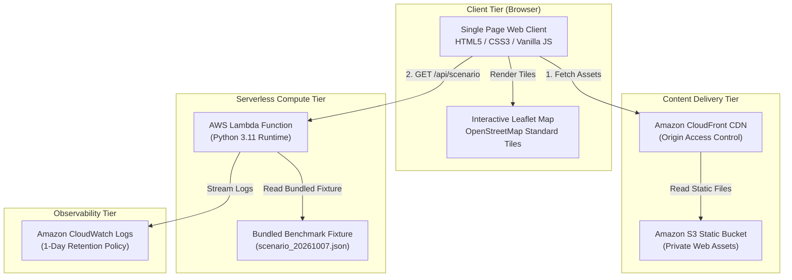

# AirGuard Decision Engine 🛡️

> **Retrospective Environmental Decision-Support Prototype for Urban Commuters in Lucknow, India**
> *Built for Environmental Hacks 2026 — Air Track &bull; Designed for AWS Serverless Architecture*

[](https://github.com/kunwaradityasingh-boy/airguard-decision-engine)
[](https://github.com/kunwaradityasingh-boy/airguard-decision-engine/tree/main)
[](#quickstart-run-locally)
[](#deployment-status--cloud-readiness)
[](https://python.org)
[](#technology-stack)
[](#automated-testing--verification)
[-brightgreen)](#security-practices--credential-hygiene)
[](LICENSE)

---

> [!CAUTION]
> **Mandatory Scientific & Non-Medical Disclaimer:**
> "AirGuard Decision Engine provides retrospective environmental scenario comparisons for algorithmic demonstration only. It does not provide medical advice or health guarantees."

---

## 1. Executive Summary & Problem Statement

In metropolitan centers across the Indo-Gangetic Plain, urban commuters regularly navigate elevated concentrations of ambient particulate matter ($PM_{2.5}$ and $PM_{10}$). A persistent behavioral heuristic among urban travelers is assuming that peripheral green-belt or cantonment bypasses deliver "cleaner air" than congested central arterials.

However, ambient regulatory monitoring networks are heavily clustered along commercial arterial cores, leaving military cantonments and green corridors virtually devoid of in-situ air quality sensors. Commuters who divert onto longer bypasses frequently incur increased travel distance and travel duration without empirical evidence of reduced particulate exposure.

**AirGuard Decision Engine** is a retrospective decision-support tool comparing ambient particulate observations and spatial monitoring coverage between two primary transit corridors connecting **Charbagh Railway Station** and **Gomti Nagar** in Lucknow, Uttar Pradesh:
1. **Route A (Hazratganj Arterial Corridor):** The traditional urban core commercial transit spine.
2. **Route B (Cantonment Bypass Corridor):** The southern military green-belt bypass.

Rather than inventing synthetic sensor readings or declaring an unmonitored path "safe," AirGuard provides an honest, scientifically grounded evaluation: it presents verified historical ambient readings alongside explicit spatial coverage disclosures, revealing that **$88.5\%$ of the Cantonment corridor has zero regulatory monitoring coverage**.

---

## 2. Objectives & Intended Users

### Objectives
* **Empirical Transparency:** Present verified regulatory station readings ($PM_{2.5}$, $PM_{10}$) without fabricating values for unmonitored road segments.
* **Observational Coverage Delineation:** Quantify the percentage of each route corridor situated within a 1.0 km proximity buffer of an active regulatory monitor.
* **Zero Synthetic Extrapolation:** Prohibit the use of unvalidated Inverse-Distance Weighting (IDW) interpolation or arbitrary traffic reduction multipliers across unmonitored green spaces.
* **Ethical Communication:** Enforce persistent scenario playback provenance notices and non-medical disclaimers; strictly eliminate claims of "cleaner paths" or "healthy routes."
* **Lightweight Serverless Architecture:** Provide a demonstrable system deployable on AWS using least-privilege access principles (zero runtime S3 permissions for compute).

### Intended Users
* **Urban Commuters & Transit Planners:** Seeking objective environmental context and route trade-off visibility.
* **Environmental Data Researchers:** Analyzing observational equity and monitoring gaps in Indian urban centers.
* **Hackathon Evaluators & Cloud Architects:** Reviewing serverless architecture, data integrity, and reproducible system design.

---

## 3. Route Corridor Scenario Comparison

All route metrics are calculated from a verified historical benchmark snapshot on **October 7, 2026, at 20:00 IST (14:30 UTC)**.

> [!NOTE]
> **Provisional Metrics Disclosure:** All route distances, durations, and monitoring coverage percentages are **provisional estimates** derived from open routing geometries and a 50-meter equidistant polyline sampling procedure. They do not account for microscale roadside vehicle plumes or historical traffic signal delays.

| Corridor Attribute | Route A (Hazratganj Arterial) | Route B (Cantonment Bypass) | Delta (Route B vs Route A) | Status |
|---|---|---|---|---|
| **Alignment** | Charbagh &rarr; Hussainganj &rarr; Hazratganj &rarr; 1090 Chauraha &rarr; Gomti Nagar | Charbagh &rarr; Mawaiya &rarr; Cantt Road &rarr; Nehru Road &rarr; VIP Road &rarr; Gomti Nagar | Southern green-belt bypass | Baseline |
| **Route Distance** | **$12.12\text{ km}$** | **$14.60\text{ km}$** | $+2.48\text{ km}$ ($+20.5\%$) | **PROVISIONAL ESTIMATE** |
| **Estimated Duration** | **$\approx 13.0\text{ min}$** | **$\approx 19.5\text{ min}$** | $+6.5\text{ min}$ ($+50.0\%$) | **PROVISIONAL FREE-FLOW** *(Traffic excluded)* |
| **Monitored Distance (1 km Buffer)** | $3.47\text{ km}$ | $1.68\text{ km}$ *(terminus only)* | $-1.79\text{ km}$ | **PROVISIONAL ESTIMATE** |
| **Monitoring Coverage %** | **$28.7\%$** | **$11.5\%$** | $-17.2\%$ | **PROVISIONAL ESTIMATE** |
| **Unmonitored Transit Gap %** | **$71.3\%$** | **$88.5\%$** | $+17.2\%$ | **CRITICAL OBSERVATIONAL GAP** |
| **Nearby Active Monitors** | Station 5659 (Lalbagh, ~450m)<br>Station 7140 (Gomti Nagar, ~200m) | Station 7140 (Gomti Nagar, ~200m at terminus only) | Zero mid-corridor stations | Verified Historical |
| **Observed Ambient PM2.5 / PM10** | Lalbagh: $43.1\ /\ 94.3\ \mu\text{g/m}^3$<br>Gomti Nagar: $13.0\ /\ 27.0\ \mu\text{g/m}^3$ | Gomti Nagar: $13.0\ /\ 27.0\ \mu\text{g/m}^3$ | Mid-corridor values **UNKNOWN** | Verified Historical |

### Critical Cantonment Disclosure
**$88.5\%$ of Route B through the Lucknow Cantonment is unmonitored.** Because ambient particulate matter is governed by regional background transport, atmospheric boundary layer dynamics, and local meteorological conditions, an unmonitored green corridor **cannot be assumed or claimed to be cleaner or safer** without empirical in-situ evidence.

---

## 4. Key Scientific Safeguards

1. **Ambient Monitors vs. In-Cabin Exposure:** Point measurements from fixed regulatory monitoring stations measure macroscale ambient air quality. They **do not reflect microscale in-vehicle commuter cabin exposure**, personal respiration rates, or vehicle air-filtration dynamics.
2. **Provisional 50-Meter Sampling Methodology:** Corridors are densified into equidistant sample nodes every 50 meters. Nodes within 1.0 km Euclidean distance of an active regulatory monitor are categorized as `MONITORED`. This geometric approximation does not model urban street canyons or local dispersion barriers.
3. **Exclusion of Traffic Delay Modeling:** Duration estimates represent nominal free-flow network travel times. Historical traffic congestion data is unavailable for this date and is explicitly excluded.
4. **Station 2456 Spatial Disambiguation:** Station 2456 (Talkatora District Industries Center: `26.833997° N, 80.891736° E`) is located **$3.12\text{ km}$ west** of Charbagh Railway Station. It is classified strictly as an **External Urban/Industrial Background Reference Monitor** and does **not** monitor the trip origin.

---

## 5. System Architecture

AirGuard is designed around the **Minimal Serverless Architecture**: a lightweight static web frontend decoupled from a serverless Python backend with zero external runtime database dependencies.



### Least-Privilege IAM Analysis
* **Why Lambda Requires ZERO Runtime S3 Access:** The historical scenario benchmark (`scenario_20261007.json`) and route GeoJSON coordinates are packaged directly inside the Lambda deployment artifact under `fixtures/`. At runtime, the function reads from the local execution filesystem (`/var/task/fixtures/...`) with sub-millisecond latency.
* **IAM Role:** The Lambda execution role requires strictly `AWSLambdaBasicExecutionRole` (`logs:CreateLogGroup`, `logs:CreateLogStream`, `logs:PutLogEvents`). No `s3:*`, `dynamodb:*`, or admin permissions are granted.
* **Cost Containment:** $0 projected monthly cost within AWS Free Tier; CloudWatch log groups are configured with an explicit 1-day retention policy to eliminate unbounded storage charges.

---

## 6. Technology Stack & Repository Layout

### Technology Stack
* **Backend:** Python 3.11+ (Standard Library only: `http.server`, `urllib.parse`, `json`, `unittest`). Zero external pip packages required.
* **Frontend:** HTML5, CSS3 (Modern high-contrast dark theme), Vanilla JavaScript (ES2022). Zero build or bundle overhead.
* **Mapping Engine:** [Leaflet 1.9.4](https://leafletjs.com/) via CDN with open, keyless [OpenStreetMap](https://www.openstreetmap.org/) tile layers.
* **Data Standards:** GeoJSON (RFC 7946), OpenAQ v3 historical archive schemas.

### Repository Layout
```
airguard-decision-engine/
├── .gitignore                   # Git exclusion rules (secrets, venv, caches)
├── ARCHITECTURE.md              # Detailed architecture & least-privilege analysis
├── GSD-STYLE.md                 # Development style guide
├── LICENSE                      # MIT Open Source License
├── PROJECT_RULES.md             # Canonical project governance & safety rules
├── README.md                    # Project documentation (this file)
├── VERSION                      # Semantic version indicator (0.2.0)
│
├── backend/                     # Backend API & fixtures
│   ├── handler.py               # Serverless Lambda handler & local HTTP server
│   ├── fixtures/                # Verified historical benchmark data
│   │   ├── routes.geojson       # Route A & B coordinates, station markers
│   │   ├── scenario_20261007.json # Canonical benchmark scenario response
│   │   └── weather_context.json # Open-Meteo ambient meteorological observations
│   └── tests/                   # Automated test suite
│       └── test_scenario.py     # 21 unit tests (validation, 405 methods, schema, whitelist, CORS, fallback)
│
├── frontend/                    # Web client (Zero-build SPA)
│   ├── index.html               # Semantic HTML single-page layout
│   ├── css/
│   │   └── style.css            # Responsive dark slate design system
│   └── js/
│       └── app.js               # Map initialization, API fetch, UI event handling
│
├── docs/                        # Research and documentation
│   └── resaerch/                # Phase 0 data feasibility paper
│       └── AirGuard_Environmental_Hacks_2026_Phase_0_Research_Paper.pdf
│
└── scripts/                     # Operational & security utilities
    ├── scan_secrets.py          # Automated repository secret scanner
    ├── search_repo.ps1 / .sh    # Repository search tools
    └── validate-all.ps1 / .sh   # GSD governance validation scripts
```

---

## 7. Quickstart: Run Locally

The application requires **zero package installations** (`pip install` and `npm install` are not needed). It runs on standard Python 3.11+ and any modern web browser.

### Step 1: Start the Backend API Server
In your terminal, start the Python backend service on port 8000:
```powershell
python backend/handler.py 8000
```
*Output: `AirGuard Decision Engine API running at http://127.0.0.1:8000/api/scenario`*

### Step 2: Start the Frontend Static Web Server
In a second terminal window, serve the `frontend/` directory on port 3000:
```powershell
python -m http.server 3000 --directory frontend
```
*Output: `Serving HTTP on :: port 3000 ...`*

### Step 3: Access the Web Application
Open your browser and navigate to:
```
http://127.0.0.1:3000
```
*The application connects to the live backend at `http://127.0.0.1:8000`, displays the green `Online (API Connected)` indicator, and renders the interactive corridor map.*

---

## 8. API Endpoints Reference

The backend exposes three RESTful endpoints with CORS enabled (`Access-Control-Allow-Origin: *`):

| Endpoint | Method | Purpose | Response Format |
|---|---|---|---|
| `/api/health` | `GET` | Service liveness probe & feature flag status | `{"status": "healthy", "service": "airguard-decision-engine", "mode": "HISTORICAL_SCENARIO", "live_ingestion_enabled": false}` |
| `/api/scenario` | `GET` | Canonical benchmark dataset, station readings, weather context, and route summaries | Structured JSON payload |
| `/api/routes` | `GET` | GeoJSON FeatureCollection containing Route A, Route B, and station points | RFC 7946 GeoJSON FeatureCollection |

### Error Handling & Malformed Input
* **Scenario ID Validation:** Requesting `/api/scenario?scenario_id=invalid` or empty returns `HTTP 400 Bad Request` with permitted scenario IDs.
* **Unrecognized Parameters:** Requesting `/api/scenario?unknown_param=xyz` returns `HTTP 400 Bad Request` with a structured list of permitted parameters.
* **Attempting Live Mode:** Requesting `/api/scenario?mode=live` returns `HTTP 400 Feature Disabled` with an explanation of upstream OpenAQ batch latency.
* **Unsupported HTTP Methods:** `POST`, `PUT`, `DELETE`, `PATCH`, and `HEAD` return `HTTP 405 Method Not Allowed` with JSON error payload and CORS headers. `HEAD` requests return 0 response body bytes (RFC 9110 §9.3.2).
* **CORS Preflight:** `OPTIONS` requests return `HTTP 204 No Content` with appropriate CORS headers.

---

## 9. Automated Testing & Verification

The test suite validates scenario ID validation, malformed query parameter handling, HTTP method restrictions (405 normalization), CORS preflight headers, fallback resilience, route GeoJSON structure, coordinate validity, station whitelisting, unmonitored segment flags, historical scope, provenance, provisional route metrics, and the mandatory health disclaimer using Python's built-in `unittest` framework:

```powershell
python -m unittest discover -s backend/tests -p "test_*.py" -v
```

### Verified Empirical Results (21/21 Passed):
```
test_empty_scenario_id_param_returns_400 (TestAirGuardBackendHandler) .. ok
test_fallback_resilience (TestAirGuardBackendHandler) ................. ok
test_get_routes_endpoint (TestAirGuardBackendHandler) ................. ok
test_get_scenario_endpoint (TestAirGuardBackendHandler) ............... ok
test_health_check_endpoint (TestAirGuardBackendHandler) ............... ok
test_invalid_scenario_id_param_returns_400 (TestAirGuardBackendHandler)  ok
test_local_request_handler_has_405_method_handlers (TestAirGuardBackendHandler) ok
test_malformed_query_parameter_returns_400 (TestAirGuardBackendHandler)  ok
test_options_cors_preflight (TestAirGuardBackendHandler) .............. ok
test_requesting_live_mode_returns_400 (TestAirGuardBackendHandler) ..... ok
test_unsupported_http_methods_return_405 (TestAirGuardBackendHandler) .. ok
test_valid_scenario_id_param_returns_200 (TestAirGuardBackendHandler) .. ok
test_geojson_feature_structure (TestAirGuardRoutesGeoJson) ............ ok
test_route_coordinates_validity (TestAirGuardRoutesGeoJson) ........... ok
test_cantonment_unmonitored_disclosure (TestAirGuardScenarioFixture) .. ok
test_fixture_provenance_and_scope (TestAirGuardScenarioFixture) ....... ok
test_mandatory_health_disclaimer_present (TestAirGuardScenarioFixture)  ok
test_provisional_metric_status_preserved (TestAirGuardScenarioFixture)  ok
test_route_a_coverage_metrics (TestAirGuardScenarioFixture) ........... ok
test_station_readings_and_roles (TestAirGuardScenarioFixture) ......... ok
test_station_whitelist_and_exclusion_of_defunct_stations .............. ok

----------------------------------------------------------------------
Ran 21 tests in 0.006s — OK
```

### JavaScript Syntax Verification
```powershell
node --check frontend/js/app.js
```
*Output: Exit Code 0 (Zero syntax errors).*

---

## 10. Security Practices & Credential Hygiene

* **Automated Secret Scanning:** Verified via `scripts/scan_secrets.py`. The scanner inspects all tracked files for AWS Access Key patterns (`AKIA...`), secret keys, private key blocks, and OpenAQ API keys:
  ```powershell
  python scripts/scan_secrets.py
  ```
  *Result: Scanned 120 repository files &bull; **PASS: Zero hardcoded secrets detected**.*
* **Strix Penetration Assessment:** Marked **`NOT VERIFIED`** *(Strix CLI 1.6.2 is installed locally and sandbox image is cached, but automated penetration scanning failed during LLM authentication before executing security probes against http://127.0.0.1:8000)*.
* **Environment Protection:** `.gitignore` enforces strict exclusion of local environment configurations, secrets directories, and PEM keys.

---

## 11. Deployment Status & Cloud Readiness

| Infrastructure Component | Architecture Specification | Current Deployment Status | Empirical Evidence |
|---|---|---|---|
| **Local Backend API** | Python 3.11 `http.server` on `127.0.0.1:8000` | **VERIFIED & RUNNING** | HTTP 200 responses verified on `/api/health`, `/api/scenario`, `/api/routes` |
| **Local Web Frontend** | Static HTTP server on `127.0.0.1:3000` | **VERIFIED & RUNNING** | Tested in browser; renders OpenStreetMap tiles, polylines, and popups |
| **AWS Lambda API** | Serverless function via Lambda Function URL | **NOT DEPLOYED / GATED** | Deployment code ready; provisioning paused pending auth clock skew fix |
| **Amazon S3 & CloudFront** | Static web hosting with Origin Access Control | **NOT DEPLOYED / GATED** | Deployment code ready; provisioning paused pending auth clock skew fix |
| **Strix Security Pen-Test** | Multi-agent dynamic security assessment | **NOT VERIFIED** | Tool installed & sandbox image cached; scan failed during model handshake prior to executing probes |

---

## 12. Visual Evidence & Interface Screenshots

> *Screenshots can be captured directly from the running local demo at `http://127.0.0.1:3000`:*

| View | Target Screenshot | Status | Visual Verification Highlights |
|---|---|---|---|
| **Full Dashboard Overview** | `docs/screenshots/01_full_dashboard_overview.png` | **Captured** | Top Historical Scenario Banner (`October 7, 2026, 20:00 IST`), green `Online` status pill, interactive corridor map, side-by-side comparison cards, persistent health disclaimer footer. |
| **Route A (Hazratganj)** | `docs/screenshots/02_route_a_hazratganj_focus.png` | **Captured** | Amber solid polyline, Lalbagh station buffer circle, interactive popup displaying $12.12\text{ km}$ (Provisional), $\approx 13.0\text{ min}$ (Free-flow), and $28.7\%$ coverage. |
| **Route B (Cantonment)** | `docs/screenshots/03_route_b_cantonment_alert.png` | **Captured** | Green dashed polyline traversing southern green belt, golden alert box highlighting the **`88.5% Unmonitored Corridor Disclosure`**. |
| **Station 2456 Separation** | `docs/screenshots/04_station_2456_background.png` | **Captured** | Map zoomed to Talkatora DIC ($3.12\text{ km}$ west of Charbagh); popup identifying it as an external background monitor that does NOT monitor origin. |
| **CLI Verification Proof** | `docs/screenshots/05_cli_test_and_scan_proof.png` | **Captured** | Terminal output displaying 21 passing tests (`Ran 21 tests in 0.006s — OK`) and secret scan (`120 files scanned — PASS`). |

---

## 13. Known Limitations & Future Roadmap

### Known Limitations
1. **Ambient Monitors vs. Microscale Inhalation:** Fixed-site regulatory monitors do not account for in-cabin vehicular ventilation, air conditioning filtration, or microscale roadside exhaust plumes.
2. **Provisional Metric Approximations:** Segment distances and coverage percentages utilize 50-meter equidistant node sampling and Euclidean buffers. They do not simulate building reflections or street canyon wind vectors.
3. **Absence of Historical Congestion:** Travel durations represent nominal free-flow network estimates because verified historical traffic delay data is unavailable for this date.

### Future Roadmap
- [ ] **Dynamic Ingestion Pipeline:** Integrate OpenAQ v3 streaming ingestion via Amazon EventBridge once upstream regulatory publishing latency improves below 1 hour.
- [ ] **Multi-Scenario Historical Exploration:** Expand DynamoDB storage to support historical playback across seasonal inversion episodes (e.g., post-monsoon vs. winter peak pollution).
- [ ] **Microscale Elevation & Terrain Modeling:** Incorporate high-resolution digital elevation models (DEM) to evaluate topographic wind dispersion along the Gomti River basin.

---

## 14. Data Sources, Attributions & Licensing

### Data Sources
* **Air Quality Monitoring Data:** [OpenAQ](https://openaq.org) v3 Historical Public Archive. Regulatory monitoring stations operated by the Uttar Pradesh Pollution Control Board (UPPCB) and Central Pollution Control Board (CPCB). Licensed under the [Open Database License (ODbL)](https://opendatacommons.org/licenses/odbl/).
* **Geospatial & Map Data:** &copy; [OpenStreetMap](https://www.openstreetmap.org/copyright) contributors. OpenStreetMap standard tile layers licensed under the [Open Database License (ODbL)](https://opendatacommons.org/licenses/odbl/).
* **Meteorological Data:** [Open-Meteo](https://open-meteo.com) Historical Weather API. Licensed under the [Creative Commons Attribution 4.0 International (CC BY 4.0)](https://creativecommons.org/licenses/by/4.0/).

### Code License
The AirGuard Decision Engine software is licensed under the [MIT License](LICENSE).
